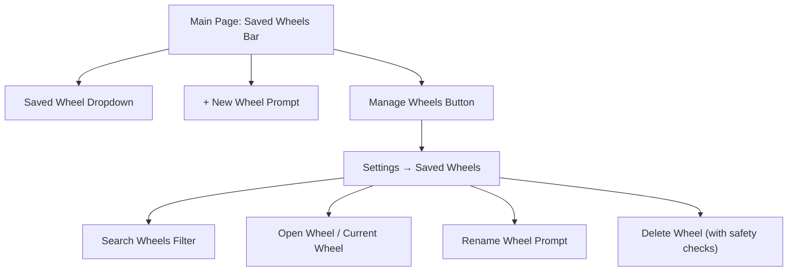

# Feature: Saved Wheels (Workspaces)

The **Letterboxd Watchlist Wheel** includes a multi-wheel saved workspace manager designed to let you curate, save, and switch between multiple isolated movie collections—without juggling backup files or losing custom slice weights.

---

## 1. What are Saved Wheels?

Saved wheels (workspaces) allow you to maintain distinct watchlists tailored to different occasions, genres, or groups of friends. 

Common wheel setups include:
* **Horror Marathon**: 31 horror films for October with custom boosts for cult classics.
* **Oscar Contenders**: Nominees and festival favorites for awards season.
* **Family Movie Night**: PG-rated animations and comedies curated for all ages.
* **Director Retrospective**: Complete filmographies (e.g. Denis Villeneuve or Hayao Miyazaki).
* **Date Night Shortlist**: A tight, agreed-upon pool of 10 movies.

Each wheel functions as an entirely independent universe within your local browser storage.

---

## 2. Isolated Wheel State

Every wheel stores its own dedicated state in `localStorage` under a unique UUID key (`letterboxd_workspace_<uuid>`). Switching between wheels never mixes or overwrites:

| State Property | Scope | Description |
| :--- | :--- | :--- |
| **Movie Catalog** | Isolated | The list of imported and custom films on this wheel. |
| **Selection State** | Isolated | Checkbox states determining which movies are active on the wheel. |
| **Slice Weights & Colors** | Isolated | Custom weights (1x to 5x) and custom slice color assignments. |
| **Boost Contributions** | Isolated | Booster names, tags, and timestamps for movie night stakes. |
| **Winner History** | Isolated | The log of previous winners and champions spun on this wheel. |
| **Game Progression** | Isolated | Ongoing Knockout Mode elimination rounds. |
| **Tied Letterboxd URL** | Isolated | The Letterboxd list or watchlist URL bound to this wheel. |
| **Theme & Preferences** | Isolated | Selected visual theme, VHS capacity, and label toggles. |

---

## 3. Managing Saved Wheels: Create, Switch, Rename, Delete

Saved wheels can be managed in two places:
1. **Saved Wheels Bar**: Positioned immediately above the import card for instant switching, quick-adding wheels via **+ New wheel**, and accessing management via **Manage wheels**.
2. **Saved Wheels Management Panel**: Located in **Settings → Saved wheels** (or opened via **Manage wheels**). Features search filtering, live match status, and direct **Open wheel** controls.



### Creating a Wheel
1. **Quick Method**: Click **+ New wheel** directly on the Saved Wheels bar above the import area, type the name, and confirm.
2. **Settings Method**: Open **Settings** → **Saved wheels**, enter a name in **New wheel name**, and click **Create wheel**.
3. The app generates a new unique ID (`crypto.randomUUID()`), initializes a fresh workspace, sets it as the active wheel, and updates storage.

### Switching Wheels
* Select any wheel from the **Saved wheels** dropdown on the main page or from **Settings → Saved wheels**.
* In the management list, click **Open wheel** on any saved wheel.
* The application automatically:
  1. Saves the current wheel's state to disk.
  2. Updates `letterboxd_active_workspace_id`.
  3. Loads the destination wheel's movies, selections, weights, and history.
  4. Triggers the `letterboxd:workspacechange` event, refreshing the wheel canvas, slice editor, and history modal without requiring a page reload.

### Renaming a Wheel
1. In **Settings → Saved wheels**, locate the wheel in the list.
2. Click **Rename**.
3. Enter the new name in the modal prompt and confirm. The index updates immediately while preserving all movie data and bindings.

### Deleting a Wheel
1. In **Settings → Saved wheels**, click **Delete** on the target wheel.
2. Confirm the custom confirmation modal.
3. The wheel's data key is removed from `localStorage`, and its entry is purged from the workspace index.

> [!CAUTION]
> **Safety Protections**:
> * You cannot delete the currently active wheel (the Delete button is disabled). Switch to another wheel first.
> * You cannot delete the last remaining wheel; the application requires at least one active wheel at all times.

---

## 4. Letterboxd List Binding & 1-Click Syncing

Each wheel can be tied directly to a live Letterboxd list or watchlist URL.

### How Binding Occurs
When you import a Letterboxd URL in Step 1, that URL is automatically bound to the active wheel (`workspace.letterboxdUrl`). In **Settings → Saved wheels**, your wheel displays its tied source:
```text
Horror Month
Updated 10/31/2026 • Letterboxd: username/list/spooky-season/
```

### 1-Click "Sync List" Banner
Whenever an active wheel has a bound URL, an active synchronization banner appears at the top of Step 1:

* **Direct Link**: Click the displayed URL to inspect the list on Letterboxd in a new tab.
* **Sync List Button**: Click **Sync List** to fetch the latest changes from Letterboxd in one click without closing or collapsing the import section.
* **Smart Reconcile**:
  * Retains manually created custom titles.
  * Adds new titles discovered on Letterboxd.
  * Prunes titles that were removed from the Letterboxd list.
  * Restores customized slice weights for existing titles.
* **Hover Tooltips**: The resulting status banner shows interactive badges detailing the exact titles added or removed.

---

## 5. Saved Wheel Conflict Resolution

Because watchlists are distinct, tying the same Letterboxd URL to two different wheels could lead to confusion. The app actively monitors against duplicate bindings.

If you paste a Letterboxd URL into Wheel B that is already bound to Wheel A, the app displays the **Saved wheel conflict** dialog:

```
+-------------------------------------------------------------+
| Saved wheel conflict                                        |
|                                                             |
| This Letterboxd URL is already tied to a different saved    |
| wheel: "Horror Month".                                      |
|                                                             |
| Did you mean to update that wheel instead?                  |
|                                                             |
| [Cancel]  [Import into current wheel anyway]  [Switch & update that wheel]
+-------------------------------------------------------------+
```

* **Switch & update that wheel** (*Recommended*): Automatically switches your active workspace to "Horror Month" and prompts to refresh or append there.
* **Import into current wheel anyway**: Imports the films into your current wheel and unbinds the URL from "Horror Month".
* **Cancel Import**: Aborts the operation, keeping all wheels and bindings intact.

---

## Related Documentation

* **[User Guide](User-Guide)**: General workflow for managing and spinning movie lists.
* **[Feature: Importing](Feature-Importing)**: Multi-page scraping, CSV uploads, and merge modes.
* **[Feature: Boost Station](Feature-Boost-Station)**: Awarding booster tags and stakes within a wheel.
